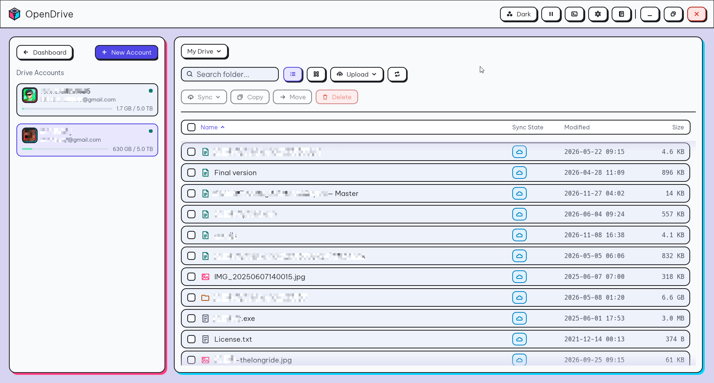

<p align="center">
  
</p>

<h1 align="center">OpenDrive</h1>

<p align="center">
  Free, open-source multi-account Google Drive desktop client (Rust).
</p>

<p align="center">
  <a href="LICENSE"></a>
  <a href="Cargo.toml"></a>
  <a href="https://github.com/the-long-ride/opendrive/actions/workflows/quality-gate.yml"></a>
  <a href="https://github.com/the-long-ride/opendrive/releases"></a>
  <a href="https://github.com/the-long-ride/opendrive/releases"></a>
  <a href="https://github.com/the-long-ride/opendrive/releases"></a>
</p>

<p align="center">
  
</p>

## Setup & Connect Google Drive Account

- Follow the step-by-step [Connect Account Guide](docs/connect-account-guide.md) (or click **Setup Guide** inside the app's **Connect** drawer) to create your own free Google Cloud OAuth 2.0 Desktop credentials or Service Account JSON key.

## Why OpenDrive Exists

Google Drive has no official Linux desktop client, and many third-party tools either restrict multi-account mounting behind paid plans or route OAuth tokens through third-party servers. **OpenDrive** solves this with a free, open-source, pure-Rust desktop client (`eframe` / `egui`, zero WebView) using your own Google Cloud credentials (`SecretStore` OS keyring + AES-GCM `.odcred` backup) and on-demand lazy hydration.

## Driverless Native Mounting & Clean Quota Display

OpenDrive requires **no custom kernel drivers** (no WinFsp, Dokany, or macFUSE):

- **Windows:** Built-in Windows Cloud Files API (`CFAPI`) and driverless **This PC** Explorer namespace shortcut (cleaning up any legacy `subst` drive mapping) — automatically hiding storage quota labels when any configured account reports an unknown or unlimited quota
- **macOS:** Built-in localhost `NFSv3` (`nfsserve`)
- **Linux:** Standard userspace `FUSE3`

Portable archives and native installers (`NSIS` `.exe`, `.dmg`, `.AppImage`, `.deb`) are published via GitHub Releases.

## Features

- **Full-Viewport Cloud Explorer:** Switch **My Drive** and **Shared with me** scopes with List/Grid views, search, folder caching, multi-select, drag-and-drop uploads, hierarchical sync badges (`Cloud`, `Indexed`, `PartialLocal`, `FullLocal`), and batch Copy/Move/Rename/Delete.
- **Explicit Sync & Token Refresh:** **Sync Down**, **Sync Up**, and verified **Sync Up & Clear Local**, backed by automatic 50-minute / HTTP `401` single-flight OAuth & Service Account token refresh.
- **Localhost `206` Streaming & Open-With Rules:** Token-gated `127.0.0.1` `206 Partial Content` video streaming (`2 MiB` chunked `StreamCache` + head/tail pre-warming) with custom per-extension, `@group`, or `*` app launcher overrides.
- **Themes, UI Fonts & Security:** Dark/Light Bento themes, searchable **UI Font** selector (system, Google Fonts, public `https://` URLs, local `.ttf`/`.otf`/`.ttc`), visual Setup Guide, OS keyring (`SecretStore`), and AES-GCM `.odcred` backups.
- **In-App Terminal & AI Support:** Credential-masked **Terminal Log** + structured `OD-*` **App Logs** with search/severity filters and copyable version-pinned **AI Support** prompts (`llm.txt`).

## CLI Commands

```bash
opendrive ui                                      # Launch desktop Control Center (default)
opendrive status                                  # Show connected accounts & config path
opendrive explore <account> [remote_path]         # List Drive folder contents
opendrive sync-down <account> <remote_path>       # Download file or folder into local cache
opendrive sync-up <account> <local_path> [parent] # Upload file or folder recursively
opendrive sync-clear <account> <remote_path>      # Upload/verify remote, then clear local copy
opendrive open-item [--dry-run] <account> <path>  # Resolve or launch item via Open-With rules
opendrive stream [--probe] <account> <path>       # Print localhost 206 stream URL (or probe range)
opendrive rename <account> <remote_path> <name>   # Rename Cloud + Local file or folder
opendrive rm|delete <account> <remote_path>       # Trash on Drive and remove local copy
opendrive cp|copy <account> <remote_path> [dest]  # Copy Cloud + Local file or folder
opendrive mv|move <account> <remote_path> <dest>  # Move Cloud + Local file or folder
opendrive --self-check                            # Run built-in end-to-end runtime self-check
```

## Development Setup

Requires **Rust** (`stable`) and **Node.js 24+**:

```bash
npm install
npm run desktop                         # Build & launch desktop UI (or VS Code F5)
cargo run -p opendrive-app --locked     # Run directly with Cargo
npm run test:gate                       # Format, lint, scripts, and >=95% coverage
```

## Roadmap

Upcoming improvements planned on top of the `v0.3.0` core (also tracked in [docs/ROADMAP.md](docs/ROADMAP.md)):

- **Explorer Collaboration & History:** File version history (Drive v3 revisions), owner card details (avatar, name, email with one-click copy), multi-email folder/file sharing permissions, and one-click Drive link copy.
- **Details & Preview Panel (Toggleable, Default ON):** Optional right-side preview/inspector panel (`Settings` toggle) displaying item previews, metadata, and recent file/folder activity.
- **New `Favorites` & `Trash` Scopes:** Add `Favorites` (user-created shortcuts and custom virtual folder hierarchies for quick navigation) and `Trash` (browse, restore, or permanently delete trashed Drive files/folders) alongside `My Drive` and `Shared with me`.
- **Built-in MCP Server (AI Agent Integration):** Expose an `opendrive mcp` Model Context Protocol server (`stdio` / localhost) wrapping Explorer listing, sync controls, file operations, and safe diagnostics so AI agents can inspect and operate connected drives with explicit permission/read-only guards.
- **Multi-Cloud Provider Support (Post-Drive Stability):** Extend the storage/sync abstraction beyond Google Drive to **OneDrive**, **Mega**, **Dropbox**, **Cloudinary**, and other providers once Google Drive file/folder workflows stabilize.

## Docs

[Building](docs/building.md) · [Connect Account Guide](docs/connect-account-guide.md) · [Architecture](docs/architecture.md) · [Roadmap](docs/ROADMAP.md) · [OAuth](docs/oauth-setup.md) · [Status](docs/M0-checklist.md) · [Next](docs/NEXT.md) · [Design](DESIGN.md)

## License

MIT
